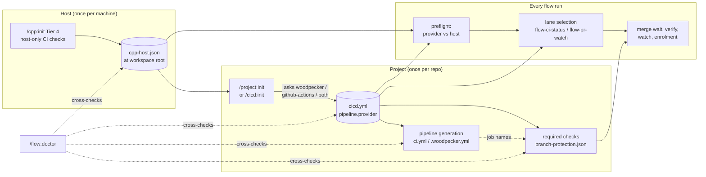
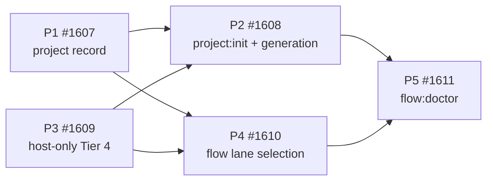

# CI provider chain: from host setup to merge

How a project's CI provider (self-hosted Woodpecker, GitHub Actions, or both)
flows from setup through every CI-dependent flow step, where the chain broke at
`46d99956`, and the plan that closes it. The decision is
[ADR 0012](../decisions/0012-per-project-ci-provider.md); this document is the
map and the task list. Tracking issue: #1612.

## The two records

| Record | Scope | Location | Written by | Holds |
|---|---|---|---|---|
| Project CI provider | one repository | `<repo>/.claude/cicd.yml` -> `pipeline.provider` | `/project:init` (new), `/cicd:init` (existing) | `woodpecker` \| `github-actions` \| `both`; absent reads `unknown` |
| Host CI capability | one workspace root | `<root>/.claude/cpp-host.json` (here `~/Projects/.claude/cpp-host.json`) | `/cpp:init` Tier 4 | per provider: `ready` \| `missing (<what>)` \| `unknown (<why>)`, tool versions, checked-at; never a secret |

Everything else - pipeline files, required status checks, which CI lane a flow
helper reads - is derived from these two records.

## Target chain

## Where it broke (audit at 46d99956)

| Link | State | Evidence |
|---|---|---|
| Host capability | **absent** | `/cpp:init` Tier 4 preflight runs only `uv,cpp_python`; the `gh` check uses a fake token; `woodpecker-cli` and the Woodpecker token are never mentioned; nothing records the result |
| Project choice | **never asked** | `/project:init` has no CI question; `templates/cicd.yml.example` leaves `pipeline:` commented; `lib/cicd/config.py` defaults to `github-actions`; CPP's own `cicd.yml` therefore names the wrong provider |
| Record -> generation | works | `lib/cicd/pipeline.py` dispatches on `pipeline.provider` |
| Generation -> required checks | **missing** | nothing derives check names; `.claude/branch-protection.json` exists only for CPP, hand-written; the `BranchProtection` model is unused |
| Required checks -> flow | **partial** | `gh-pr-merge.sh` and `/project:next` read GitHub's rollup and are provider-neutral; `flow-ci-status.sh` lane order lets Woodpecker claim any repo it knows; `flow-pr-watch.sh` is blind on Actions; enrolment is a step in CPP's own `.woodpecker.yml` only; recovery text is Woodpecker-only |
| Drift detection | **absent** | `/flow:doctor` only checks that some pipeline file exists |

## Plan

Five work packages, one issue each, in dependency order. P1 and P3 can run in
parallel; P2 needs P1; P4 needs P1 and P3; P5 comes last.

### P1 - One recorded provider per project, failing closed (#1607)

- [ ] `pipeline.provider` absent resolves to `unknown`; validation stops passing an absent value as `github-actions`.
- [ ] Add the single reader `python -m lib.cicd provider --path <repo>`, printing `CICD_PROVIDER: <value> (<source>)`; a test fails if a flow helper parses `cicd.yml` for `provider` itself.
- [ ] Add a writer (`pipeline --provider X --record`) so a choice is persisted, not just applied to one run.
- [ ] Uncomment the template's `pipeline:` block with no default value and a "required" comment.
- [ ] Generation refuses on `unknown` and names the fix.
- [ ] Record `pipeline.provider: woodpecker` in CPP's own `.claude/cicd.yml`.
- [ ] Negative control: a config without `pipeline:` reads `unknown` (the pre-change model reads `github-actions`).

### P2 - `/project:init` asks, records, generates (#1608)

- [ ] `/project:init` asks woodpecker / github-actions / both, writes the answer through P1's writer, and generates the matching pipeline.
- [ ] `/cicd:init` asks the same question for an existing repository, so both entry points converge on one record.
- [ ] Derive required checks from the provider and the generated job names, and write `.claude/branch-protection.json` (wire `BranchProtection` into `CICDConfig`). Apply with `scripts/branch-protection.sh` only after explicit approval.
  - GitHub Actions: job `ci` in workflow `CI` reports as `ci`; **a strategy matrix reports one check per cell** (`ci (3.11)`), so derivation must expand the matrix.
  - Woodpecker: `ci/woodpecker/pr/woodpecker` (pr lane) and `ci/woodpecker/push/woodpecker`; a `.woodpecker/` directory names one check per file.
- [ ] Check the choice against the host record (P3) and warn when this host cannot use it.
- [ ] `/cicd:pipeline` reads or asks for the recorded provider instead of telling the user to hand-edit YAML, and its overwrite check covers `.woodpecker.yml` too.
- [ ] `/cicd:infra-pipeline` accepts `both`.
- [ ] The resume check and summary report the provider, not just file presence.
- [ ] Negative control: a `branch-protection.json` whose check the recorded provider does not produce is reported inconsistent.

### P3 - `/cpp:init` Tier 4 becomes host-only CI checks (#1609)

- [ ] Replace Tier 4's project generation (4a-4e) with host checks: `gh` installed and `gh auth status` for GitHub Actions; `woodpecker-cli` authenticated and the Woodpecker token resolvable (environment or AWS secret, never printed) for Woodpecker.
- [ ] Ask once for the workspace root (default: the parent of the CPP checkout) and write `<root>/.claude/cpp-host.json`.
- [ ] Tier 4 ends with a one-line handoff to `/project:init` / `/cicd:init`; its disclosure, undo and consent text change to match.
- [ ] Negative controls: failing `gh auth status` reads `missing`; an unresolvable token reads `missing`; a probe error reads `unknown`, never `ready`; the record contains no secret value.

### P4 - Flow helpers select the lane from the record (#1610)

Absorbs #1604 items 6 (`flow-pr-watch.sh`), 8 (enrolment as an Actions job) and 11 (docs for both providers).

- [ ] `flow-ci-status.sh` and `flow-pr-watch.sh` select their lane from P1's reader: one lane for `woodpecker` or `github-actions`, both for `both` (any red is red), stop on `unknown`. Probing survives only as a fallback that says it is one.
- [ ] `flow-pr-watch.sh` derives its check from protection and the record, accepts Actions run URLs, and extracts failing tests with `gh run view --log-failed`.
- [ ] Finish/merge preflight compares the project provider with the host record and stops early with a named remedy.
- [ ] Enrolment as a job in both providers' generated templates, per the owner's fork-PR ruling (open).
- [ ] `derive_event` reads rulesets and `.checks`, as `gh-pr-merge.sh` already does.
- [ ] Recovery and docs text per provider: `auto.md`, `merge.md`, `wave.md`, `register.md`, the lexicon example.
- [ ] Negative controls: a Woodpecker-known repo whose commit ran only on Actions, recorded `github-actions`, resolves on the Actions lane; `flow-pr-watch` reports a red Actions check instead of timing out.

### P5 - `/flow:doctor` cross-checks the four signals (#1611)

- [ ] One line per relationship - recorded provider vs pipeline files, vs required checks, vs host capability, plus any lane fallback that would trigger - each `ok | drift (<what>) | unknown (<why>)`.
- [ ] Negative controls per drift line; CPP's own pre-P1 state is the first red case.

## Out of scope here

#1604 keeps items 7 (`gh-pr-merge.sh` keys required checks by app plus name),
9 (hardening `/cicd:pipeline`'s Actions output) and 10 (`branch-protection.sh`
records the app id of each check). They harden the Actions path but do not
decide which path a project is on.
